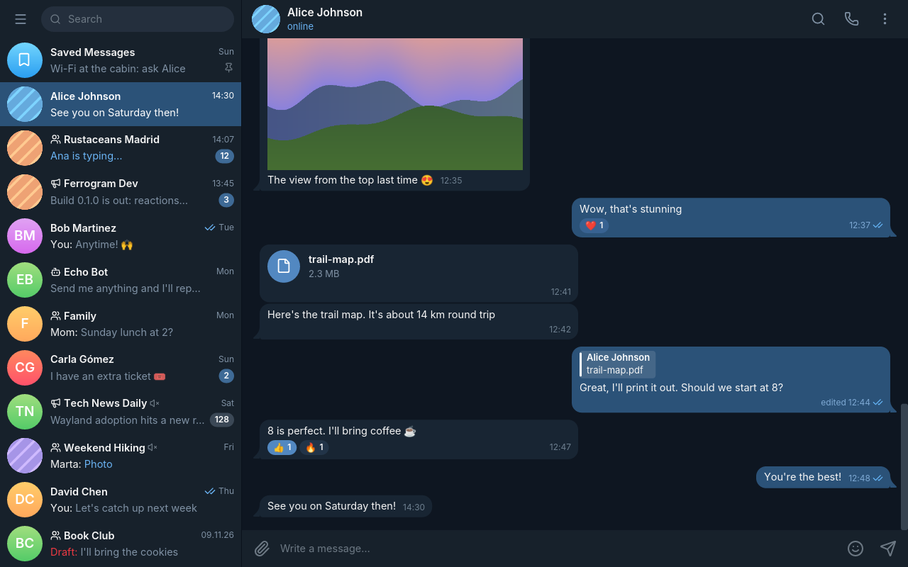

# Ferrogram

A lightweight, native Telegram desktop client written in Rust, with a look
modelled on Telegram Desktop's dark theme.

> **Unofficial client.** Ferrogram is not made, endorsed or supported by
> Telegram. It uses the public Telegram API through the pure-Rust
> [grammers](https://codeberg.org/Lonami/grammers) MTProto library. Telegram
> names and trademarks belong to their owners; no Telegram logos, icons or
> fonts are shipped (the UI uses Inter and Lucide icons).



## Features

* Login with phone number → code → two-step (cloud) password (SRP).
* Chat list with avatars, last message preview, time, read checks, pinned and
  muted chats, unread badges.
* Infinite-scroll history: the local SQLite cache first, then the network.
* Send and receive text, photos and files in real time (update stream);
  attach with the file chooser or drag & drop.
* Replies, edits, deletes, reactions (right-click a message; double-click to
  reply). Edits and deletes are optimistic and roll back if the server
  refuses.
* Clicking a received file downloads it to a private cache and opens it with
  your system's default application. Executables, installers and scripts
  (`.exe`, `.sh`, `.desktop`, `.AppImage`, …) are never opened: you are
  asked where to save them. **Save As…** in the context menu works for any
  file.
* Profile photos for chats and users (cached on disk, bounded; initials are
  the fallback).
* "typing…", "recording voice message…" and last seen / online in the header
  and chat list; your own typing action is sent while you compose.
* Drafts per chat, synced with your other devices.
* The chat list loads more chats as you scroll.
* Global search across all chats (server side), jumping to the hit.
* Attachments (from the file chooser or drag & drop) show a preview bar and
  are only sent after you confirm.
* Search: chats, cached messages and server-side results in the sidebar,
  server-side search inside a chat.

Not implemented yet: voice-message playback, video thumbnails, sticker
rendering, forwarding, archived chats and folders.
* Desktop notifications (D-Bus), muted chats and the focused chat excluded.
* The session is restored from the OS keyring on start. The auth key is stored
  only as an encrypted blob whose key lives in the keyring.
* Offline start: with a saved session and no network, the cached chats stay
  visible and the session restore is retried with backoff. You are never
  sent back to the phone screen just because you are offline.

## Install

Download `ferrogram-vX.Y.Z-linux-x86_64.tar.gz` from the
[Releases](https://github.com/Dasemu/Ferrogram/releases) page, then:

```sh
tar xzf ferrogram-*-linux-x86_64.tar.gz
cd ferrogram-*-linux-x86_64
./ferrogram --install-desktop-entry   # adds Ferrogram to the KDE/GNOME app menu
./ferrogram
```

Then log in like in the official app: phone number → code → two-step
password if you have one. Release builds ship with Ferrogram's own Telegram
API credentials, so there is nothing to configure.
`./ferrogram --version` shows whether a build has them.

`--install-desktop-entry` writes `dev.ferro.ferrogram.desktop` to
`~/.local/share/applications/` and the icon to
`~/.local/share/icons/hicolor/scalable/apps/`. The entry's `Exec` points at
the binary you ran it from.

## Build

Requires Rust stable (edition 2024) and, on Linux, these development
packages:

```sh
sudo apt-get install pkg-config libdbus-1-dev libxkbcommon-dev libwayland-dev \
    libx11-dev libfontconfig1-dev
cargo build --release
```

Windows and macOS builds should work (iced, keyring and notify-rust support
them) but are not the main target.

## Telegram API credentials

Every Telegram client identifies itself with an `api_id` and `api_hash`
registered at my.telegram.org. Ferrogram resolves them at runtime in this
order:

1. **Your own override**: the small *"Advanced: use your own API
   credentials"* link on the login screen, or `ferrogram --api-setup`. The
   `api_hash` is stored only in the OS keyring (`dev.ferro.ferrogram` /
   `api-hash`); the `api_id` goes to `~/.config/ferrogram/config.ini`
   (mode 0600). *Use built-in credentials* on the same screen removes it.
2. **Runtime environment** (for developers): `FERROGRAM_API_ID` and
   `FERROGRAM_API_HASH`.
3. **Built-in values**, embedded at compile time in official release builds.

A development build without any of these shows the setup screen, with a note
that official release builds don't need it.

To build with your own app's values embedded:

```sh
FERROGRAM_API_ID=123456 FERROGRAM_API_HASH=0123456789abcdef0123456789abcdef \
  cargo build --release
```

`build.rs` validates them: the id must be a positive integer and the hash
exactly 32 hex characters. Malformed values fail the build. Never commit
real values. Local `.env*` files are git-ignored.

> **About the "secret":** the `api_hash` identifies the *application*, not
> you. It can be extracted from any distributed binary, which is true of
> every Telegram client, official ones included. It is not a user secret and
> gives no access to anyone's account. Your account is protected by your
> login code, your 2FA password and the session key in your keyring.

### Maintainers: credentials for release builds

1. Log in at <https://my.telegram.org> → **API development tools** → create
   an application for Ferrogram (do not reuse Telegram Desktop's id).
2. Copy its `api_id` and `api_hash`.
3. In GitHub, open the repository's **Settings → Secrets and variables →
   Actions** and add the repository secrets `TELEGRAM_API_ID` and
   `TELEGRAM_API_HASH`.
4. Push a `v*` tag (`git tag v0.2.0 && git push origin v0.2.0`), or run the
   **Release** workflow manually (*Actions → Release → Run workflow*, which
   creates a draft release).

`.github/workflows/release.yml` fails immediately if either secret is missing.
It checks that `--version` reports built-in credentials, and uploads
`ferrogram-<tag>-linux-x86_64.tar.gz` and its `.sha256` file to the GitHub
Release. The tarball holds the binary, the README, the licences, the desktop
entry and the icon. CI (`ci.yml`) never needs the secrets.

## Run

```sh
./target/release/ferrogram           # real account (see credentials above)
./target/release/ferrogram --mock    # demo data, no network, nothing stored
```

`--mock` login codes: `12345` asks for the 2FA password `hunter2`; `22222`
signs in directly. In mock mode "Echo Bot" replies to whatever you send.

Environment variables: `FERRO_THEME=light`, `FERRO_RENDERER=wgpu` (GPU renderer; the default is the CPU renderer tiny-skia, ~30 MB idle), `FERRO_TRACE_STARTUP=1` (logs
`first_frame_ms`), `FERROGRAM_NOTIFY_SENDER_ONLY=1`, `FERROGRAM_NO_NOTIFY=1`,
`RUST_LOG=debug`.

Files:

* `~/.local/share/ferrogram/cache.sqlite3` is the message cache. It is
  **plain text** (SQLite), owner-only (directory 0700, files 0600), and safe
  to delete.
* `~/.local/share/ferrogram/session.enc` is the encrypted MTProto session.
  Its key lives in the keyring.
* `~/.local/state/ferrogram/log` is the log file, with phone numbers and
  bodies redacted.

A Secret Service provider (KWallet or GNOME Keyring) is required. Without one,
Ferrogram refuses to store the session or the API hash. If the session can't
be decrypted (for example, the keyring was reset), it is discarded and you
are asked to log in again.

`FERROGRAM_PROTOCOL_DEBUG=1` allows grammers' debug/trace logs, which contain
raw protocol data and are **not** redacted. Without it, those targets stay at
`warn` even with `RUST_LOG=trace`.

## Screenshots

Rendered with mock data:

```sh
ICED_BACKEND=tiny-skia xvfb-run -a -s "-screen 0 1280x800x24" \
  ./target/debug/ferrogram --mock --screenshot chats docs/screenshots/chats.png
```

Screens: `login-phone`, `login-code`, `login-password`, `chats`, `search`,
`reply`, `media`.

## Development

```sh
cargo fmt --check
cargo clippy --all-targets -- -D warnings
cargo test
```

See [`docs/architecture.md`](docs/architecture.md) and
[`docs/protocol.md`](docs/protocol.md).

## Licence

MIT. Inter is under the SIL Open Font License 1.1
(`assets/fonts/Inter-LICENSE.txt`); Lucide icons are under the ISC licence
(`assets/icons/LICENSE.txt`).
